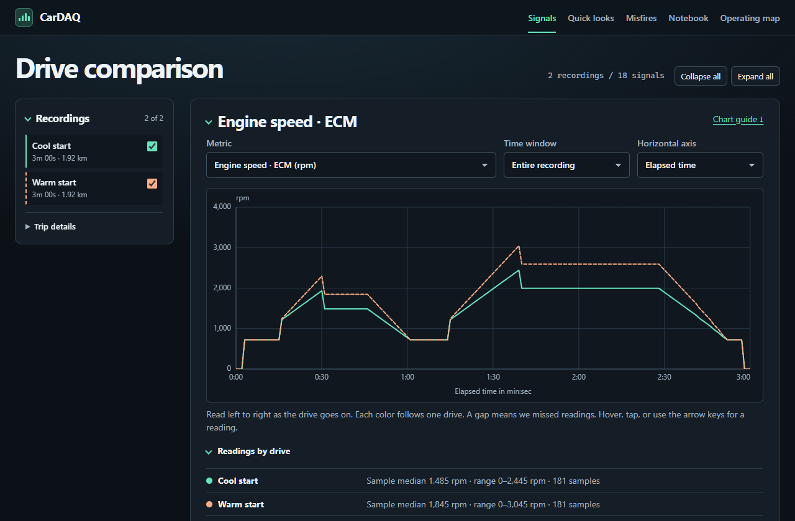

# CarDAQ

CarDAQ records OBD-II data to CSV and turns one or more recordings into an interactive HTML dashboard. Compare two drives at the same road speed, see how long the coolant took to warm up, or select a stop to inspect the samples around it. The viewer runs locally in a browser.

The recorder was developed on a **2020 Honda Civic LX sedan, 2.0 L with CVT**, using a **USB OBDLink EX on Windows**. It reads standard engine data and two Honda transmission identifiers. The viewer and test suite run without a vehicle. [Hardware verification](docs/changes/0002-pid-sweep/report.md#physical-validation-and-obdwiz-comparison)

## Try the viewer

To browse your recording library, run the following from the repository root and open the local address it prints.

```sh
uv run --locked cardaq serve
```

The viewer watches `captures/recordings/` and its date subfolders while the command runs. New and changed CSVs appear automatically. In **Signals**, choose **Vehicle speed · ECM** as the metric and **Engine speed · ECM** as the overlay to compare road speed and RPM on the same graph. Press Ctrl+C in the serving terminal to stop.

From the repository root, use uv with Python 3.11 or later. The generator creates two fictional three-minute trips with identical road speeds, different starting coolant temperatures, and different engine RPM. [Install uv](https://docs.astral.sh/uv/getting-started/installation/)

```sh
uv sync --locked
uv run --locked python examples/generate_demo.py
uv run --locked cardaq view captures/demo/synthetic-cool.csv captures/demo/synthetic-warm.csv --label "Cool start" --label "Warm start" --output captures/demo/comparison.html
```

Open `captures/demo/comparison.html` in your browser. Select **Engine speed · ECM** and switch the horizontal axis to **Observed distance**. Both trips cover 1.92 km, but the warm-start example turns about 920 more engine revolutions. In the **Trip notebook**, select a launch to zoom in on the readings around it.



To compare your own drives, pass their CSV paths to `cardaq view`. Supply one `--label` per file or let the viewer use the filenames. Each HTML export embeds the selected drives and works offline. [Capture format and viewer guide](docs/RECORDINGS.md)

## Record a drive

While parked, connect the USB OBDLink, switch the ignition on, and run this from the repository root.

```sh
uv run --locked cardaq go
```

CarDAQ reads the VIN, prints the vehicle and polling profile, and saves a file such as `20261128T130600Z_2021-toyota-rav4-xle-12ab34cd56ef.csv`. The first part is the UTC start time. The last 12 hex characters identify the individual car across trips. Wait for `Ready` before driving. Once parked, press Ctrl+C to finish early. Use `cardaq view` to open a saved drive or `cardaq serve` to browse the library. [Recording guide](docs/RECORDINGS.md) · [Example configuration](cardaq.example.toml)

The 2020 Civic LX CVT and 2021 RAV4 XLE VIN patterns are recognized offline. Other readable VINs get their own stable ID and use standard CAN OBD-II polling. For a first drive, sample the advertised channels and check a short parked recording. [First drive in another vehicle](docs/RECORDINGS.md#first-drive-in-another-vehicle)

## Track one vehicle over time

`cardaq health` follows cylinder misfire counters, closed-loop fuel trims, warm idle RPM and coolant, and candidate CVT slip and ratio movement under comparable cruise conditions. Add each independent drive to a local TOML manifest. Give it a comparison group such as outbound in Drive, and record relevant changes in mode or maintenance.

```sh
uv run --locked cardaq health captures/health/health-history.toml
```

The offline report shows observed counts from the first trip and builds per-trip references as comparable drives accumulate. A JSON export is also available. [Manifest example and interpretation guide](docs/HEALTH_HISTORY.md)

The November 24 review summarizes what the two commutes establish and how to build a pre-service baseline from repeat drives. [Project progress report](docs/changes/0013-progress-review/report.md) · [Next milestones](docs/ROADMAP.md)

## Acoustic and vibration instrumentation

Does a whine rise in pitch with engine RPM or with road speed? The Civic instrumentation project is designed to investigate questions like this by recording sound and vibration alongside OBD data. The proposed rig has ten accelerometers and four microphones across three ESP32 hubs. The hubs would send samples over Wi-Fi to a Raspberry Pi 4B, which would also collect RPM and road speed from the USB OBDLink EX. [System drawing](hardware/system.svg)

CarDAQ records the OBD side today. The sensor harnesses, hub schematic and power drawings are available for bench work. The front hub, with four accelerometers and two microphones, is the first planned assembly. Hub firmware and Pi sensor capture are still development work. [Hardware drawings](hardware/README.md) · [Front hub checkout](hardware/bench.md)

## Contribute

The contributor guide covers installing the Git hooks, running the offline tests, and tracing a raw reply to a plotted signal. It also describes the evidence that helps verify a new mapping. [Contributing](CONTRIBUTING.md) · [Development roadmap](docs/ROADMAP.md) · [Derived signal roadmap](docs/DERIVED_SIGNALS_ROADMAP.md)

CarDAQ's original code, documentation, and examples use the MIT license. The Honda field tables adapted from OBDb carry CC BY-SA 4.0. [License](LICENSE) · [Third-party notices](THIRD_PARTY_NOTICES.md)
