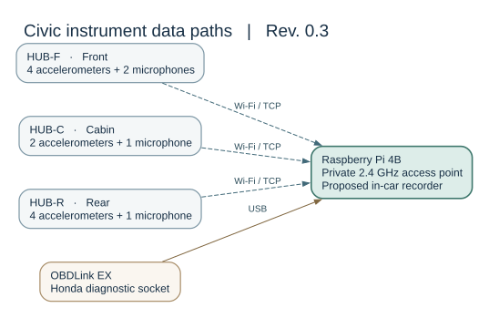
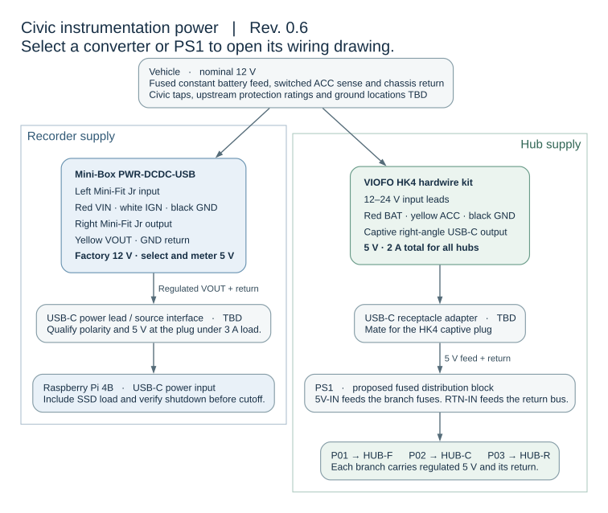

# Civic instrumentation drawings

This package describes the proposed acoustic and vibration rig for the **2020 Honda Civic LX sedan, 2.0 L CVT**. Start with **HUB-F**, the front acquisition hub. It has four ADXL345 accelerometers, two MAX4466 microphone breakouts and two 8 ft accelerometer leads. It exercises every port on the standard hub before that design is repeated at the cabin and rear.

The **Rev. 0.6 power drawings** trace the two owned converters from the Civic supply to their loads. The hub circuit and direct-bus bench drawing are at **Rev. 0.4**. The three sensor harnesses are at **Rev. 0.3**.

| Drawing or record | What to use it for |
| --- | --- |
| [Front harness](wiring/generated/HUB-F.svg) · [Cabin](wiring/generated/HUB-C.svg) · [Rear](wiring/generated/HUB-R.svg) | Follow each labeled cable from a hub port to its instrument. Lengths are routing allowances in feet. |
| [Vehicle power overview](power.svg) | Open the SVG in a browser and select either converter or the PS1 distribution block to see its wiring. |
| [Mini-Box → Raspberry Pi 4B](wiring/generated/pi-power.svg) | Trace the vehicle leads to the input contacts and the regulated output contacts to the proposed USB-C supply for the recorder. |
| [VIOFO HK4 → PS1](wiring/generated/hk4-hub-power.svg) · [PS1 → three ESP32 hubs](wiring/generated/power.svg) | Follow the kit's captive plug through its proposed adapter to PS1. Both sheets meet at 5V-IN and RTN-IN. From there, follow P01–P03 to the carrier headers. |
| [Standard hub schematic (PDF)](schematic/standard-hub.pdf) · [KiCad source](schematic/standard-hub.kicad_sch) | Trace a port to its ESP32 GPIO and inspect the proposed signal conditioning and switching circuits. |
| [Direct SPI bus bench drawing](schematic/direct-bus.svg) · [Editable source](schematic/direct-bus.dot) | Locate the clock and data jumpers for the bench comparison with U2 removed. |
| [ESP32 carrier header](esp32-header.md) | Find an assigned GPIO on the owned 30-pin ESP32-WROOM-32 development board, with the USB connector facing down. |
| [Cable and instrument assignments](wiring/cable_schedule.csv) · [Connector schedule](wiring/generated/connector_schedule.csv) · [Wiring bill of materials](wiring/generated/wiring_bom.csv) | Look up a cable ID, check the expected endpoints, or estimate harness materials. |
| [WireViz sources and regeneration](wiring/README.md) · [Bench checkout](bench.md) | Revise the drawings, identify the actual boards and collect measurements against this revision. |

## How the recorders connect



The **selected architecture** uses three identical ESP32 hubs and a Pi-hosted private 2.4 GHz network. The proposed locations are near the firewall, under the dash and inside the trunk. Each hub samples locally, buffers measurements and sends them to the Pi. The OBDLink handles communication with the vehicle. Only the OBD path currently has a CarDAQ recorder. The sensor link and Pi installation are design targets. [Current recording support](../docs/RECORDINGS.md#connect-an-adapter)

## How the instruments get power



**Pi 4B and SSD — Mini-Box PWR-DCDC-USB.** Use the right-hand Mini-Fit Jr regulated VOUT and GND for the proposed Pi power lead. Mini-USB-B is the converter's configuration port. VAUX carries switched vehicle input voltage. **Factory VOUT is 12 V.** The v1.0c guide lists a 5 V setting on page 3, but its text and figure disagree on jumper numbering. Confirm the board revision, select 5 V, power-cycle and meter the output with the Pi disconnected. Qualify a 3 A-capable USB-C source interface and cable at the Pi end before attaching the Pi and SSD. The converter's 10 A marking refers to its input fuse. [Supplied Mini-Box guide, pp. 2–5](docs/PWR-DCDC-USB-manual.pdf#page=2) · [Pi 4B plug requirement](https://www.raspberrypi.com/documentation/computers/getting-started.html#power-supply)

For controlled shutdown, the proposed automotive configuration uses persistent battery power and a switched IGN sense. OFFDELAY sets the interval from ignition loss to the motherboard power-button pulse. HARDOFF sets how long power stays on after the pulse. Measure both intervals with the dummy load attached. Once a Pi-compatible shutdown interface is fitted, verify the recorder finishes writing and the Pi halts before cutoff. Low battery can shorten the available interval. [Mini-Box timing modes, p. 4](docs/PWR-DCDC-USB-manual.pdf#page=4) · [Bench checkout](bench.md)

**ESP32 hubs — VIOFO HK4.** The captive USB-C output is rated **5 V, 2 A total**. A mating power interface and proposed PS1 fused distribution block split that single output into P01, P02 and P03. The earlier 3 A aggregate design target exceeds the HK4 rating. Before selecting it for permanent service, measure the simultaneous startup and Wi-Fi peaks of all three populated hubs and voltage at the far end of P03. The red lead takes constant battery power. Yellow senses ACC and black is the return. The kit supports parking-mode power after key-off. Check the behavior of the hubs without a VIOFO camera, including standby draw and low-voltage cutoff. [Supplied HK4 manual, pp. 2–3](docs/HK4%20Hardwire%20Kit%20English%20Manual.pdf#page=2) · [Branch harness](wiring/generated/power.svg)

The regulated outputs feed separate loads and share the vehicle return system. Civic tap positions, upstream fuse ratings, ground locations and the two USB-C adapters still require selection. The HK4 guide identifies its kit leads and explains how to distinguish constant battery power from switched ACC at the fuse box. [HK4 installation, p. 3](docs/HK4%20Hardwire%20Kit%20English%20Manual.pdf#page=3)

## Inventory and acquisition targets

| Item | Rev. 0.3 inventory and intended use |
| --- | --- |
| ADXL345 breakout ×10 | Owned. Three axes at 800 samples/s, ±16 g, full resolution. Document mounting orientation and the breakout's regulator and pull resistors before fitting it. |
| MAX4466 microphone breakout ×4 | Owned. Target 32 kHz per channel at the ADC, filtered to 16 kHz for storage. Record the board variant, gain setting, mounting and any wind or weather protection. |
| ESP32 development board ×3 | One owned ESP32-WROOM-32 on the documented 2 × 15 carrier, two proposed. VIN circuitry, regulator rating and available sensor current need confirmation. [Header and board references](esp32-header.md) |
| SN74LV4052A ×3 | Optional, one per hub. The proposed switched configuration isolates inactive SCK and SDIO cable branches. Compare it with direct wiring on the bench. |
| Raspberry Pi 4B, 8 GB · Pi 5, 16 GB | Both owned. The Pi 4B is the intended in-car recorder. The Pi 5 is the development platform. |
| Mini-Box PWR-DCDC-USB ×1 · VIOFO HK4 ×1 | Owned, assigned to the Pi and hub branches respectively. The proposed power adapters, fused distribution and shutdown interface require selection. |
| OBDLink EX ×1 | Owned. Provides OBD operating context such as RPM. Inter-hub timing and the relationship between sensor samples and OBD replies require measurement. |

At the proposed stored rates the 14 instruments produce **176 kB/s** of payload, about **634 MB/hour**, using 16-bit storage words. Keeping native-rate microphone samples for checkout gives 304 kB/s, about 1.09 GB/hour. Both estimates exclude OBD, timestamps and framing. For each real test, keep the drawing revision, instrument IDs, axis directions, mounting, microphone gain and clock reference with the recording. [Capture library](../docs/RECORDINGS.md#local-capture-library) · [Bench procedure](bench.md)

## Drawing conventions

- **Follow the IDs.** For example, `HUB-F J1` connects to `ACC-01` through `W101`. `J1` is local to one hub. `W101` identifies one cable across the vehicle. On the referenced carrier J1 chip select goes to GPIO13, position L13. Check the orientation against the [header map](esp32-header.md) before assembly.
- **Edit the owner of the detail.** Cable assignments, colors, pins and shield terminations belong in the WireViz inputs. Component values and electrical connections inside the hub belong in the KiCad source. A change at a connector affects both drawings. Recheck the pin-by-pin agreement and regenerate the affected outputs.
- **Keep evidence with the revision.** SELECTED means a working architecture decision. PROPOSED identifies a bench candidate. TBD identifies a missing specification. Use MEASURED for an observation with its test conditions and VALIDATED for a result that met a stated acceptance criterion. The pinouts, cable lengths and component values in this release are preliminary.

The sensor IC references support the signal names, supply checks and test settings. Breakout header order, fitted passives and microphone gain still depend on the actual boards. [Analog Devices ADXL345 datasheet](https://www.analog.com/media/en/technical-documentation/data-sheets/adxl345.pdf) · [MAX4466 family datasheet](docs/MAX4465-MAX4469.pdf) · [ESP32 header map and references](esp32-header.md) · [TI multiplexer datasheet](https://www.ti.com/lit/ds/symlink/sn74lv4052a.pdf)

## Regenerate the drawings

Run from the repository root with Graphviz `dot`, uv and `kicad-cli` on PATH. Edit the [data paths](system.dot), [supply overview](power.dot), [wiring inputs](wiring/README.md) or [hub circuit](schematic/standard-hub.kicad_sch), then run the corresponding command.

```sh
dot -Tsvg hardware/system.dot -o hardware/system.svg
dot -Tsvg hardware/power.dot -o hardware/power.svg
dot -Tsvg hardware/schematic/direct-bus.dot -o hardware/schematic/direct-bus.svg
uv run --script hardware/wiring/render.py
kicad-cli sch export pdf --no-background-color -o hardware/schematic/standard-hub.pdf hardware/schematic/standard-hub.kicad_sch
```

For the Windows checkout, open PowerShell in the repo root and run the following once per shell before the commands above. It uses KiCad 10 from Program Files and a portable Graphviz tree in the ignored `build/graphviz/` directory. To set up another clone, extract the Graphviz Windows archive there or use an installed `dot` on PATH. The exported SVGs and PDF open directly. [Graphviz distributions](https://graphviz.org/download/)

```powershell
$env:Path = "$PWD\build\graphviz\bin;$env:ProgramFiles\KiCad\10.0\bin;$env:Path"
```
